<!-- Generated by docs/render.py from docs/src/README.md. Edit the source, then run: python docs/render.py -->

<p align="center">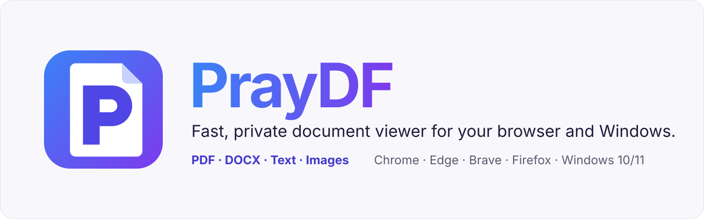</p>

<p align="center">   </p>

<a id="praydf"></a>
<p align="center">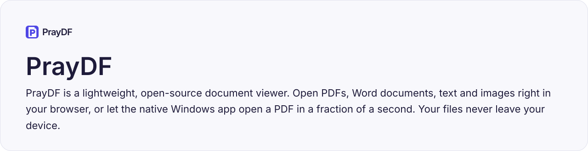</p>
<p align="center"><sub><a href="https://github.com/arvamadax/PrayDF/releases/latest">Download</a> · <a href="#install">Install</a> · <a href="#build-from-source">Build from source</a> · <a href="CONTRIBUTING.md">Contributing</a> · <a href="CHANGELOG.md">Changelog</a></sub></p>

<a id="why-praydf"></a>
<p align="center">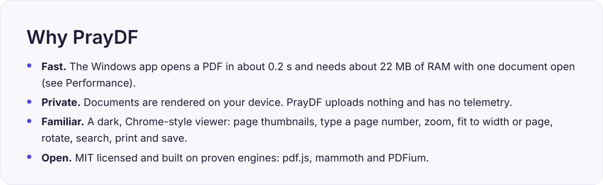</p>

<a id="features"></a>
<p align="center">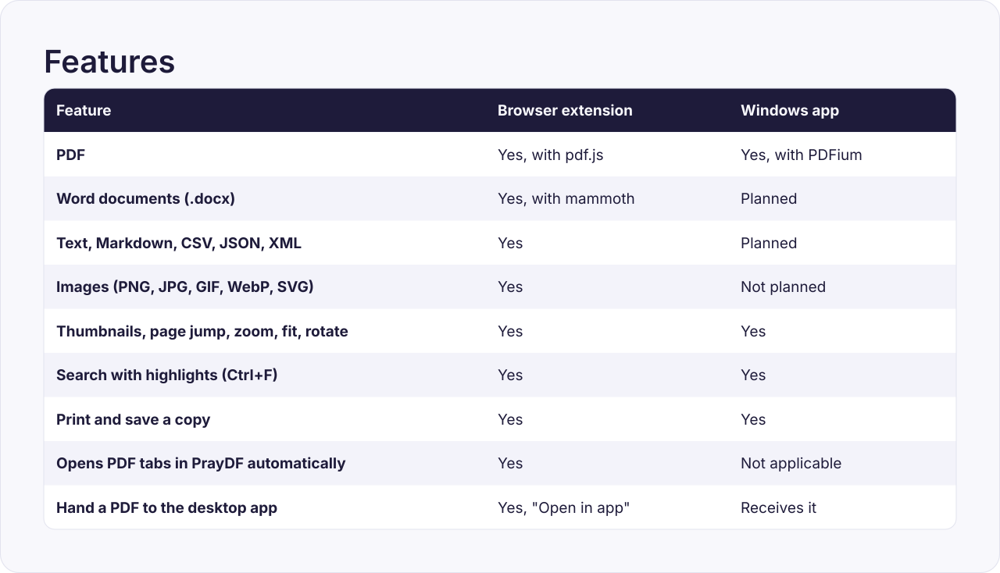</p>

<a id="screenshots"></a>
<p align="center">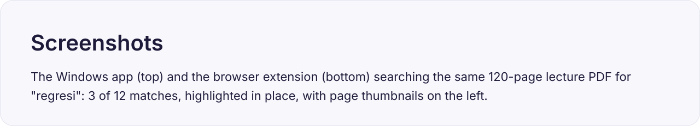</p>

<p align="center">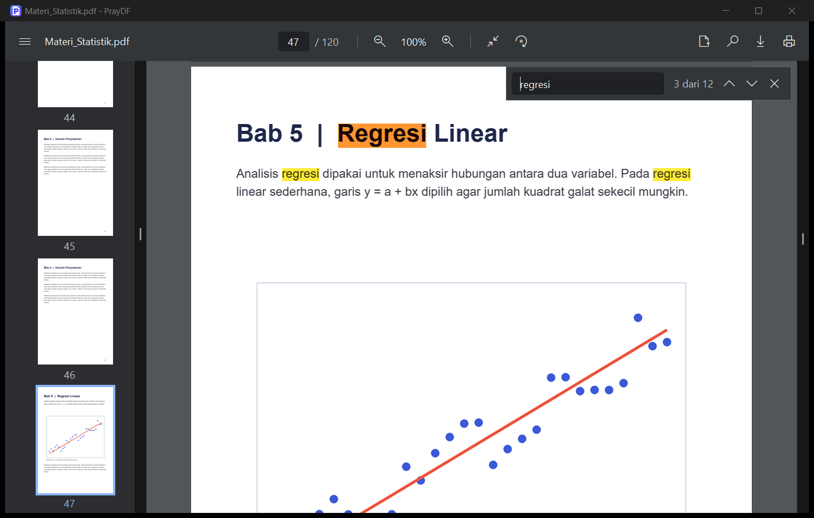</p>

<p align="center">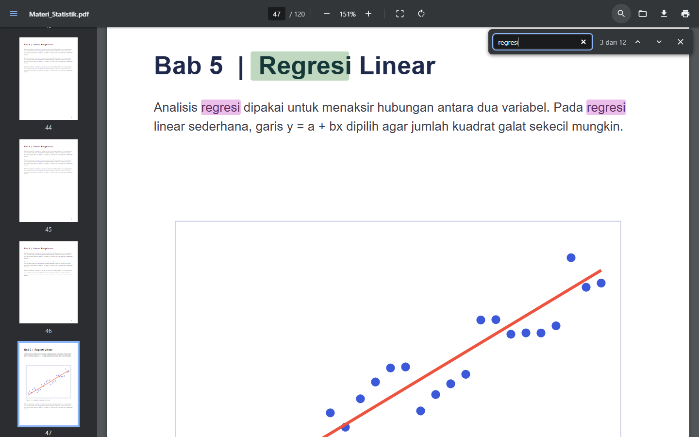</p>

<a id="install"></a>
<p align="center"></p>
<p align="center"><sub><a href="https://github.com/arvamadax/PrayDF/releases/latest">latest release</a></sub></p>

<a id="build-from-source"></a>
<p align="center">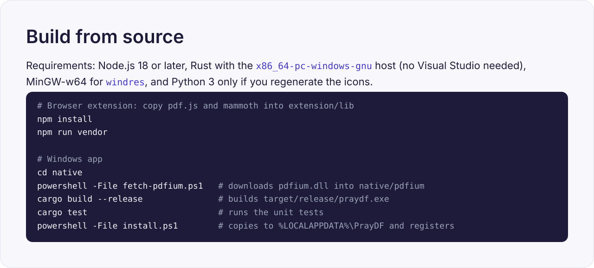</p>
<details><summary>Copy the commands</summary>

```bash
# Browser extension: copy pdf.js and mammoth into extension/lib
npm install
npm run vendor

# Windows app
cd native
powershell -File fetch-pdfium.ps1   # downloads pdfium.dll into native/pdfium
cargo build --release               # builds target/release/praydf.exe
cargo test                          # runs the unit tests
powershell -File install.ps1        # copies to %LOCALAPPDATA%\PrayDF and registers
```

</details>

<a id="how-it-works"></a>
<p align="center"></p>

<p align="center">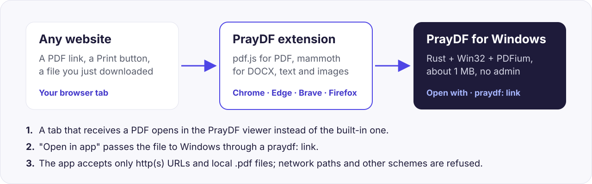</p>

<a id="performance"></a>
<p align="center">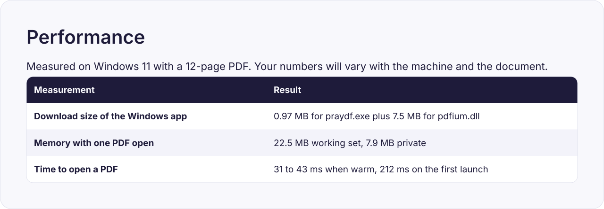</p>

<a id="privacy-and-security"></a>
<p align="center"></p>
<p align="center"><sub><a href="SECURITY.md">SECURITY.md</a></sub></p>

<a id="project-structure"></a>
<p align="center">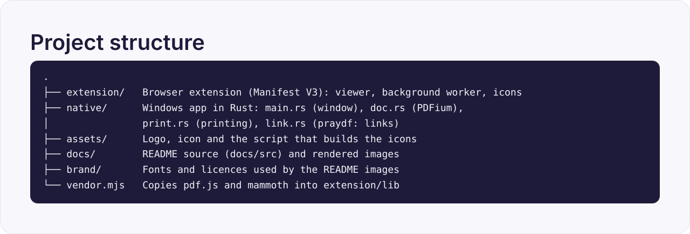</p>
<details><summary>Copy the commands</summary>

```bash
.
├── extension/   Browser extension (Manifest V3): viewer, background worker, icons
├── native/      Windows app in Rust: main.rs (window), doc.rs (PDFium),
│                print.rs (printing), link.rs (praydf: links)
├── assets/      Logo, icon and the script that builds the icons
├── docs/        README source (docs/src) and rendered images
├── brand/       Fonts and licences used by the README images
└── vendor.mjs   Copies pdf.js and mammoth into extension/lib
```

</details>

<a id="roadmap"></a>
<p align="center">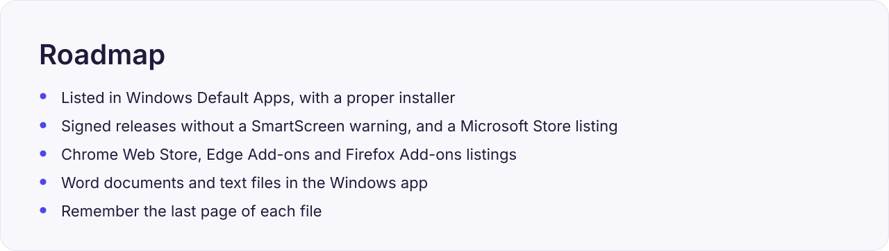</p>

<a id="contributing"></a>
<p align="center"></p>
<p align="center"><sub><a href="CONTRIBUTING.md">CONTRIBUTING.md</a> · <a href="CODE_OF_CONDUCT.md">Code of Conduct</a> · <a href="https://github.com/arvamadax/PrayDF/issues">issue</a></sub></p>

<a id="license"></a>
<p align="center">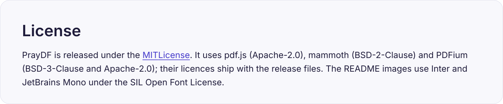</p>
<p align="center"><sub><a href="LICENSE">MIT License</a></sub></p>
